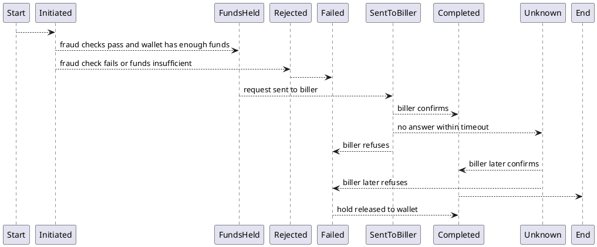
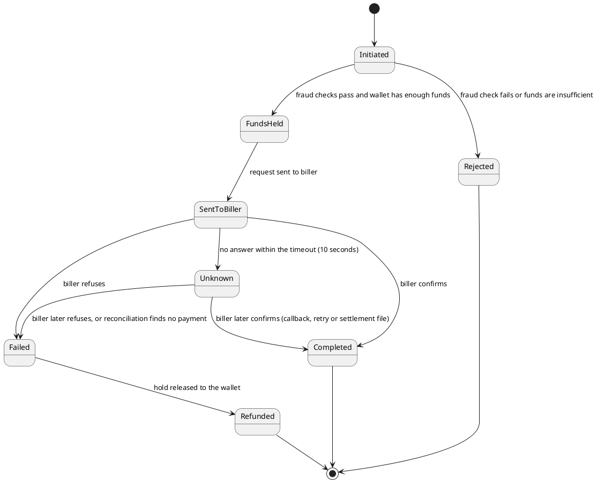

# PayLink — Payment Life Cycle State Diagram
## AI Design Prompt, Technical Review & Accepted Correction

* **Date:** 2026-11-24
* **Author:** Mohamed Ahmed (Architecture Lead)
* **Workflow:**
  * **Prompt Optimization & Engineering:** Gemini 3.8 Flash (High)
  * **PlantUML Diagram Generation:** ChatGPT
* **Target Deliverable:** [`docs/design/state-payment.puml`](file:///d:/Projects/fullStack%20in%20progress/PayLink/docs/design/state-payment.puml)
* **Brief References:** Section 2.5 (pp. 4–5), Section 4 Phase 1 Item 2 (p. 11), FR-11 (p. 8)

---

### 1. Specification & Context

Each payment occupies exactly one state at any time. The specification defines eight canonical states and exactly nine allowed transitions.

* **Canonical States (8):** `Initiated`, `FundsHeld`, `SentToBiller`, `Completed`, `Failed`, `Unknown`, `Rejected`, `Refunded`
* **Final States (3):** `Completed`, `Rejected`, `Refunded`
* **Critical Rule:** A payment in `Unknown` is **never** refunded automatically. Money is only returned once the system is certain the biller did not receive it.

---

### 2. Initial Optimized Prompt

```text
ROLE:
You are a senior software engineer who writes precise UML diagrams in PlantUML.

CONTEXT:
I am designing PayLink, a bill-payment and wallet backend. Customers pay electricity, water, mobile, and internet bills from a wallet. Every payment is in exactly one state at any time. The allowed states and transitions are fixed by the specification below.

STATES:
Initiated • FundsHeld • SentToBiller • Completed • Failed • Unknown • Rejected • Refunded

ALLOWED TRANSITIONS:
1. Initiated -> FundsHeld: Fraud checks pass and the wallet has enough funds.
2. Initiated -> Rejected: Fraud check fails or funds are insufficient.
3. FundsHeld -> SentToBiller: Request sent to biller.
4. SentToBiller -> Completed: Biller confirms.
5. SentToBiller -> Failed: Biller refuses.
6. SentToBiller -> Unknown: No answer within the timeout (10 seconds).
7. Unknown -> Completed: Biller later confirms (callback, retry, or settlement file).
8. Unknown -> Failed: Biller later refuses, or reconciliation finds no payment.
9. Failed -> Refunded: Hold released to the wallet.

CONSTRAINTS:
- Use exactly the eight states and nine transitions above. Do not add, remove, or rename any state or transition.
- No direct transition from Completed to anything.
- No direct transition from Unknown to Refunded.
- Label every transition with its event text.
- Mark the three final states with a transition to [*].

FINAL-STATE RULE:
Completed, Rejected, and Refunded are final. Unknown must not be refunded automatically.

OUTPUT FORMAT:
One PlantUML state diagram inside a single @startuml ... @enduml block, with no explanation before or after it.

EXAMPLE OF THE REQUESTED STYLE:
@startuml
[*] --> Initiated
Initiated --> FundsHeld : fraud checks pass and funds sufficient
@enduml
```

---

### 3. First AI Output (Rejected)



---

### 4. Technical Review & Defect Identification

Upon rigorous engineering review, the first generated output was found to contain multiple critical domain and UML defects:

1. **Incorrect Refund Destination & Missing State:** The lower-right `Failed` state pointed to `Completed` with the label *"hold released to wallet"*. The `Refunded` state was omitted entirely.
2. **Invalid Outgoing Transition:** The diagram introduced `Rejected -> Failed`. In PayLink's specification, `Rejected` is an immutable terminal state with no outgoing transitions.
3. **Duplicate State Boxes:** `Failed` and `Completed` each appeared twice instead of transitions converging on single state entities.
4. **Invalid UML Notation:** `Start` and `End` were rendered as rectangular states instead of standard UML `[*]` pseudostates.
5. **Missing Terminal Connections:** Only `Completed` connected to `End`. `Rejected` and `Refunded` were disconnected from final state markers.
6. **Incomplete Event Labels:** Transition labels on `Unknown` omitted required specifics (*callback, retry or settlement file* / *or reconciliation finds no payment*).

---

### 5. Corrective Prompt

```text
Fix and apply the following PlantUML state diagram:
- Restore the missing 'Refunded' state.
- Remove the invalid transition 'Rejected -> Failed'.
- Remove duplicate state boxes for 'Failed' and 'Completed'.
- Use standard UML pseudostates [*] for initial and final states (Completed, Rejected, Refunded must each connect to [*]).
- Ensure all nine transitions and their exact event labels match the specification.
```

---

### 6. Final Accepted Output



* **Verdict:** Fixed and accepted into [`docs/design/state-payment.puml`](file:///d:/Projects/fullStack%20in%20progress/PayLink/docs/design/state-payment.puml).
